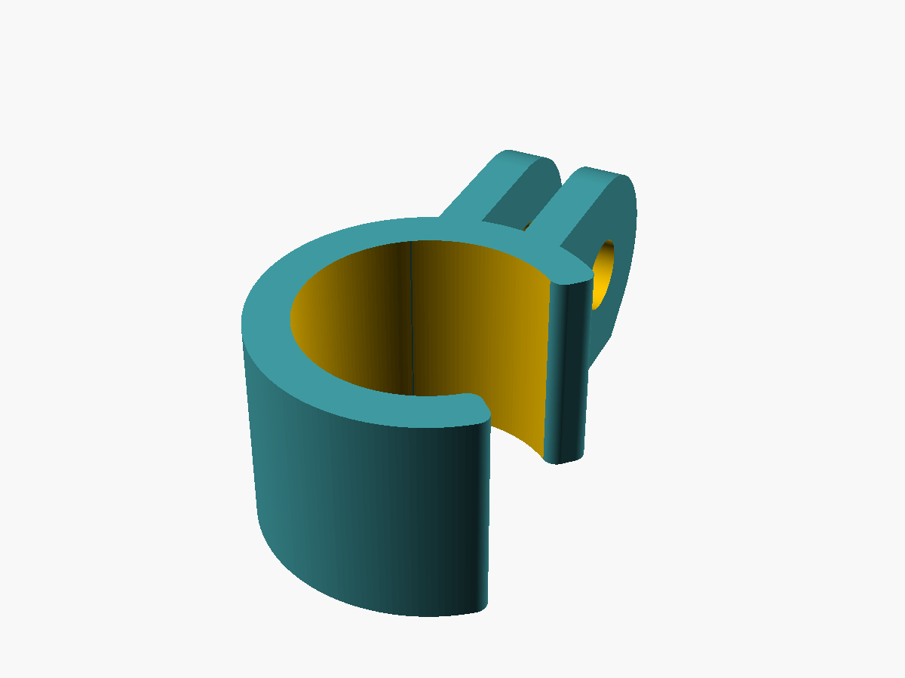
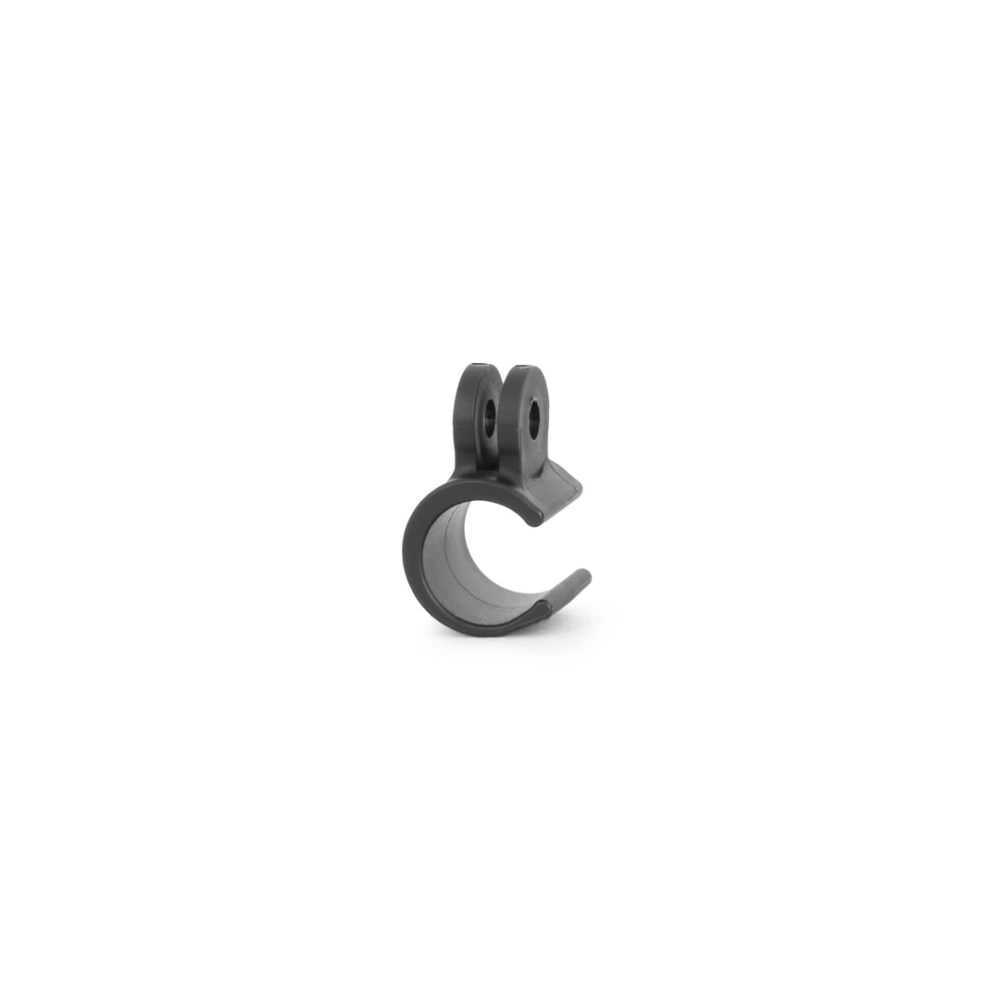

# Držiak svetla na bicykel – GoPro klip pre Exposure Tracer

Nacvakávací držiak, ktorý z ľubovoľného valcového svetla urobí svetlo s **GoPro úchytom** (samec, 2 zuby). Navrhnutý pre **Exposure Lights Tracer / Trace** (telo Ø 18 mm), ale priemer svetla sa dá zmeniť v Customizeri.

Os skrutky M5 je **kolmo na os svetla**, takže sa svetlo na štandardnom GoPro držiaku (riadidlá, sedlovka, prilba) nakláňa hore a dole.

Predloha (originálny diel): 

## Súbory
| Súbor | Čo to je |
|---|---|
| `scad/exposure_clip.scad` | hlavný model |
| `scad/exposure_clip.json` | sady parametrov z Customizera (pozri nižšie) |
| `stl/EXP18_90_fit050_wl4.stl` | export predvolenej sady: ústa 90°, presah −0,50, stena 3,06 mm (wall loops 4) |
| `stl/EXP18_100_fit030_wl3.stl` | export mäkšej sady: ústa 100°, presah −0,30, stena 2,31 mm (wall loops 3) |
| `stl/EXP18_GoPro_clip_A_snap_90_fit050_w30.stl` | pôvodný export so stenou 3,0 mm (pred prechodom na hrúbku z perimetrov), k nemu `.3mf` |
| `3mf/EXP18_GoPro_clip_A_snap_90_fit050_w30.3mf` | projekt z Bambu Studia |
| `nahlady/exposure_clip.png` | náhľad z OpenSCAD |
| `nahlady/predloha_original.jpg` | fotka originálneho dielu, podľa ktorého vznikol návrh |
| `README.en.md` | anglický popis (pre MakerWorld) |

## Hlavné rozmery a parametre
| Parameter | Predvolené | Význam |
|---|---|---|
| `priemer_svetla` | 18,0 mm | priemer tela svetla |
| `sirka` | 15,0 mm | šírka objímky, min. 15 (= šírka GoPro zuba) |
| `presah` | −0,50 mm | presah na priemere, záporný = objímka zviera |
| `uhol_otvoru` | 90° | uhol úst „C“ |
| `r_hrotov` | 1,0 mm | nábeh na hrotoch úst |
| `wall_loops` | 4 | hrúbka objímky = 2 × wall_loops liniek |
| `tryska` / `vrstva` | 0,4 / 0,20 | podľa nich sa počíta hrúbka steny |

Odvodené hodnoty (ECHO, predvolená sada): **stena 3,06 mm (8 liniek)**, otvor Ø 17,50, vonkajší Ø 23,62, šírka úst 12,37 mm. Celkovo ~20 × 39 × 15 mm.

GoPro úchyt (konštanty, netreba meniť): 2 zuby × 2,9 mm, medzera 3,2 mm, R 7,5, diera Ø 5,3 pre M5, os skrutky 8 mm nad povrchom objímky (0,5 mm vôľa pre stredný zub protikusu).

### Ladenie
- Ide nasadiť príliš ľahko alebo padá → `presah` −0,15 smerom k zápornejšiemu, `uhol_otvoru` 95.
- Praská pri nacvaknutí → `presah` bližšie k nule, `uhol_otvoru` 100–105, prípadne o 1 wall loop menej.
- Tuhosť rastie s treťou mocninou hrúbky: wall loops 4 (3,06 mm) je ~2,3× tuhší ako 3 (2,31 mm).
- Otáčanie okolo svetla drží len trenie (`presah`). Ak treba viac, daj dovnútra pásik omotávky alebo 0,5 mm TPU vložku.
- ASA sa zmršťuje o ~0,4–0,7 %, teda až ~0,1 mm na priemere navyše k presahu. Ak klip nejde nasadiť, pred zmenou `presah` najprv zmeraj skutočný vnútorný priemer posuvkou.

## Konštrukčné rozhodnutia
- **Objímka „C“ s ústami** – nacvakne sa bez náradia, svetlo sa dá rýchlo dať dole. Hroty úst majú nábeh R 1, aby sa svetlo ľahšie navlieklo.
- **Hrúbka objímky z perimetrov** – stena je presne 2 × wall_loops liniek, takže je celá z perimetrov bez gap fill. Pre pružný klip je to dôležité: súvislé perimetre po obvode sú najpevnejšie v ohybe. Pôvodná stena 3,0 mm sa zmenila na 3,06 mm (8 liniek pri 0,4/0,20), čo je ~6 % tuhšie. Pôvodne otestovaná stena 2,5 mm sa čistými perimetrami nedá dosiahnuť, najbližšia je sada `EXP18_100_fit030_wl3` s 2,31 mm.
- **Orientácia** – objímka leží plochou stranou na doske, os svetla je zvislá. Vrstvy idú pozdĺž ohybu „C“, takže klip pri nacvaknutí nepraská medzi vrstvami.
- **GoPro zub zarovno s doskou** – zub je široký 15 mm ako objímka a začína na Z = 0, takže diel stojí celou plochou na doske.
- **Materiál ASA** – odolá UV aj teplu, na slnku nemäkne ani nežltne. PETG ide tiež. **PLA nie** – pri nacvaknutí praská (model to stráži cez `assert`).
- **Previsy** (kontrola STL):
  - diera M5 je **okrúhla** Ø 5,3. Jej malý strop H2C vytlačí bez podpier, slza by bola zbytočná,
  - pod zaobleným koncom GoPro zubov je **45° pätka** (dotyčnica v 45° bode kruhu, siaha 3,1 mm za os, do výšky 2,2 mm). Spodný roh zuba tak vytŕča ~0,6 mm za kruh R 7,5. Leží len v hrúbke vlastných zubov, kam protikus nezasahuje.

  Pôvodný export `EXP18_GoPro_clip_A_snap_90_fit050_w30.stl` má zub bez pätky.

## Nastavenie slicera
0,4 tryska · 0,20 vrstva · **wall loops 4** · top/bottom 4/4 · výplň 40 % gyroid · **ASA (AMS HT)** · Textured PEI + lepidlo · **brim** · komora zavretá a vyhrievaná 50–65 °C (inak sa vrstvy v ústach, kde je najväčšie napätie, môžu rozlepiť) · podpery nie.

## Výsledky tlače
| Dátum | Sada | Materiál | Výsledok |
|---|---|---|---|
| 2026-09-20 | ústa 100°, presah −0,30, stena 2,5 mm | ASA, H2C | drží pevne, nacvakne sa a dá dole bez problémov |
| 2026-10-13 | ústa 90°, presah −0,50, stena 3,0 mm | ASA | `.3mf` pripravený, výsledok nezapísaný |

Čas a gramy zo slicera zatiaľ chýbajú (objem dielu ~3,3 cm³).

## Ako pokračovať
- Render (z priečinka projektu): `openscad --backend=manifold -o stl/EXP18_90_fit050_wl4.stl -p scad/exposure_clip.json -P EXP18_90_fit050_wl4 scad/exposure_clip.scad`
- Náhľad: `openscad --render -o nahlady/exposure_clip.png --imgsize=1200,900 --viewall --autocenter --colorscheme=Tomorrow scad/exposure_clip.scad`
- Doplniť výsledok tlače sady 90° / −0,50 a čas a gramy zo slicera.
