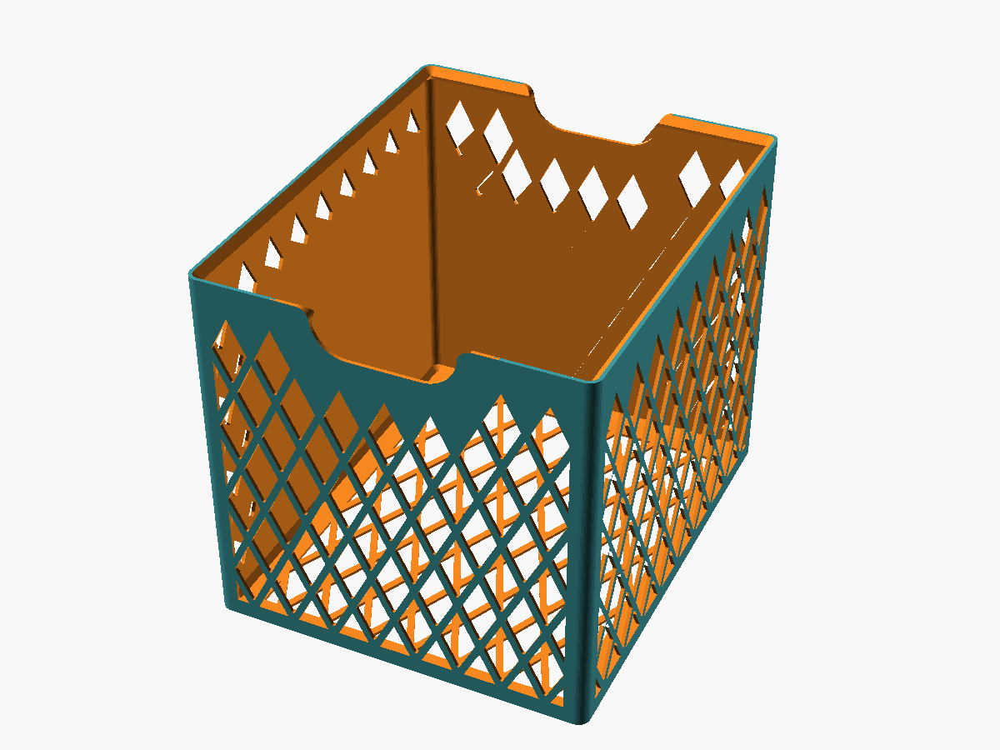
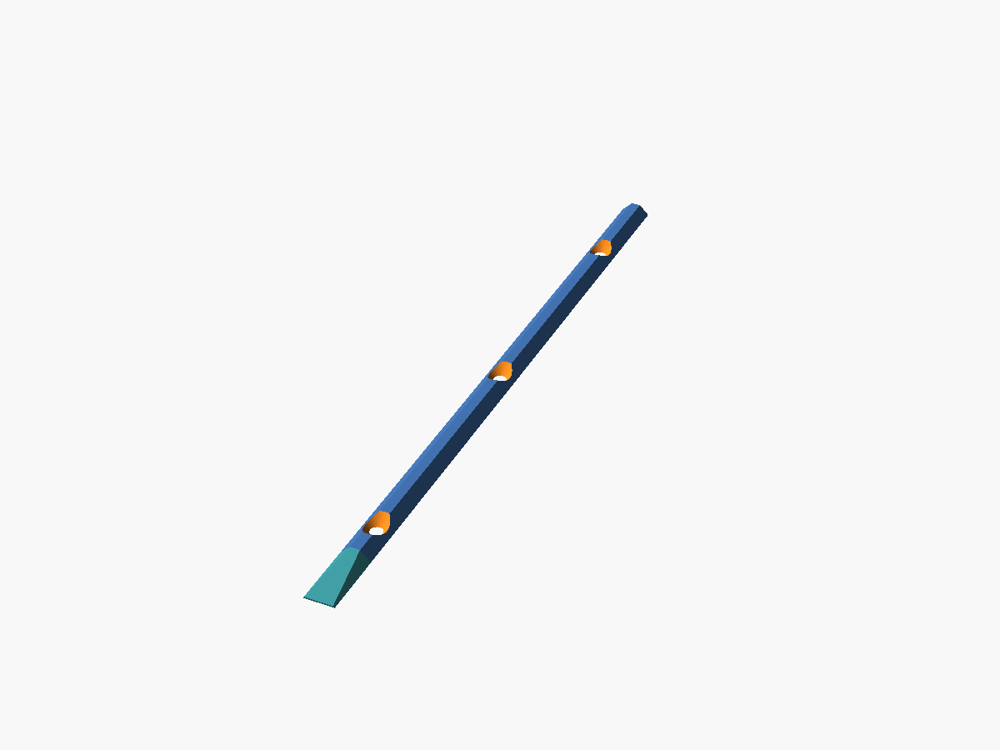

# Košíky do skrine + vodiaca lista

Parametrické stohovateľné košíky na cyklo oblečenie do skrine a lišta, ktorá ich na polici vedie a drží v rade. Všetko PLA, tryska 0,6 mm (košík aj 0,8 mm High Flow), bez podpier.

## Súbory
| Súbor | Čo to je |
|---|---|
| `scad/kosik.scad` | košík – hlavný model |
| `scad/kosik.json` | sady parametrov z Customizera (sada 3 = šírka 180) |
| `scad/lista.scad`, `scad/lista.json` | vodiaca lista – model a sady parametrov |
| `stl/kosik_<sirka>_<stoh_kusov>.stl` | exporty: `250_1/2/3` = šírka 250 pre stoh 1/2/3 kusy, `180_1`, `200_1` = užšie košíky (výška 250, 1 kus) |
| `stl/lista.stl` | export vodiacej lišty |
| `3mf/kosik.3mf` | projekt z Bambu Studia (nastavenia slicera) |
| `vyroba/vyrobny-checklist-kosiky.xlsx` | čo je vytlačené, čo zostáva, kontroly pred/po tlači |
| `nahlady/kosik.png`, `nahlady/lista.png` | náhľady z OpenSCAD |

STL sú export k dátumu exportu – pri pochybnosti radšej vyrenderuj znova z `.scad`.

---

## Košík (`kosik.scad`)

### Ako sa používa
Menia sa len vonkajšie rozmery **`sirka` × `hlbka` × `vyska`**, **`stoh_kusov`** a sekcia **Tlac**: `tryska` (0,6 alebo 0,8), `linky_steny` (2–4) a `vrstvy_dna` (Podla trysky alebo 3–7). Hrúbky a rebrá závisia od nich, nie od veľkosti košíka – pri väčšom košíku pribudnú oká, nezväčšia sa.

- `vyska` = celková výška **stohu**, `stoh_kusov` = koľko košíkov na sebe ju má dať. Výška jedného kusu sa dopočíta:
  `h_kosika = (vyska + (stoh_kusov - 1) * zapad) / stoh_kusov`, kde `zapad = skos_dole - stena` (predvolene 2,7 mm pri tryske 0,6, 1,98 mm pri 0,8).
  ECHO vypíše výšku košíka aj kontrolnú výšku stohu.
- Príklady pre stoh 250 mm a trysku 0,6: 1 ks = 250, 2 ks = 126,35, 3 ks = 85,13. Pre nerovnaký stoh (125 + 127,7) daj `stoh_kusov = 1` a `vyska` priamo.
- Voľby: `uchyt` (výrez na prsty vpredu aj vzadu), `steny_mriezka`, `dno_mriezka` (šetrí ~100 g), `polovicne_oka_steny`, `polovicne_oka_dno`.

### Nastavenie slicera
Parametre sekcie Tlac nastavia model, v Bambu Studiu treba zvoliť zodpovedajúci profil. **Wall loops = `linky_steny`, bottom shells = vrstvy dna.** ECHO vypíše všetky hodnoty.

| `tryska` | Vrstva | Wall loops | Bottom shells | Stena | Rebro | Dno |
|---|---|---|---|---|---|---|
| 0,6 | 0,30 | **4** | 7 | 2,3 mm | 4,6 mm | 2,1 mm |
| 0,8 High Flow | 0,40 | **4** | 5 | 3,02 mm | 6,04 mm | 2,0 mm |
| 0,8 High Flow, odľahčený | 0,40 | **3** | 4 | 2,29 mm | 4,58 mm | 1,6 mm |
| 0,8 High Flow, najľahší | 0,40 | **2** | 3 | 1,55 mm | 3,1 mm | 1,2 mm |

Spoločné: podpery nie · Textured PEI · Sport mode je OK (kontroluj podextrudovanie).

### Kľúčové konštrukčné rozhodnutia (prečo je to takto)
- **Stena** = `linky_steny` celých liniek, predvolene 4 (2,3 mm pri 0,62/0,3, 3,02 mm pri 0,82/0,4) → čisto z perimetrov. **Rebro mriežky = 2 × stena = dvojnásobok liniek** → preto wall loops = `linky_steny` (rebro vyplnia perimetre z oboch susedných dier, žiadna výplň, žiadny gap fill).
- **Stena s 3 linkami** má nepárny počet liniek, v sliceri skontroluj v náhľade, či v nej nevzniká gap fill.
- **Dno** = predvolene 7 vrstiev po 0,3 alebo 5 vrstiev po 0,4, zmeniť sa dá cez `vrstvy_dna`.
- **Tryska 0,8 so 4 linkami pridá materiál:** košík 250 × 300 × 250 má 554 cm³ namiesto 397 cm³ (+40 %, odhad z objemu modelu). So 3 linkami a 4 vrstvami dna má 380 cm³, teda o niečo menej ako pri 0,6. Pri mriežke je úspora času menšia, preto pred sériou porovnaj čas v sliceri. Košíky z oboch trysiek sa dajú stohovať, ale výška stohu sa na každom spoji líši asi o 0,7 mm.
- **Diamantová mriežka, oko 30/60 (pomer 1:2):** hrany ~27° od zvislice → bez podpier; o ~20 % menej materiálu ako 24/48. Horný vrchol diamantu je ostrý (strop diery bez previsu), ostatné rohy zaoblené R 1,2.
- **Rozteč sa dopasuje na plochu** (`round(L / oko_x)`), aby oká vyšli celé.
- **Polovičné oká** na okrajoch mriežky (steny: dole a po bokoch, **hore nie** – vznikol by vodorovný strop; dno: všetky 4 strany). Orezané o pol rebra od okraja.
- **Výrez úchytu:** oká, ktoré by doň zasiahli, sa vynechajú celé (žiadne orezané oká = žiadne vodorovné stropy). Prechod výrezu do hornej hrany je zaoblený R 8.
- **Plné pásy:** zvislý stĺpik v rohu (`okraj_roh = r_roh + 4`), pás nad dnom 8 mm, pás pod hornou hranou s **vnútorným trojuholníkovým lemom 5 mm (45°/45°)** – najlacnejšia výstuha hornej hrany, tlačí sa bez podpier.
- **Spodná hrana skosená 45° × 5 mm** zvonka a vnútri rovnobežne (konštantná hrúbka steny). Pri stohovaní spodné skosenie horného košíka sedí na hornej 45° ploche lemu dolného → zapadne o `zapad`. Assert stráži, aby `stena < skos_dole < stena + lem`.
- Rohy košíka R 8, okraj dna plný (`r_roh + 10`).

### Spotreba (odhad zo slicera, bez polovičných ôk)
~8 h 30 min a ~350 g na košík ~126 mm, ~6 h 50 min a ~305 g na ~85 mm. Stav výroby → `vyroba/vyrobny-checklist-kosiky.xlsx`.

---

## Vodiaca lista (`lista.scad`)

### Princíp
Lišta sa priskrutkuje na policu do medzery medzi košíky (`typ = "stred"`) alebo ku stene skrine (`typ = "kraj"`). Boky hrebeňa majú 45° a sú rovnobežné so spodným skosením košíka → košík sa pri zasúvaní sám vycentruje a nemôže ujsť do strany. **Košík stojí na polici, nie na lište** (hrebeň končí `rezerva_h = 1 mm` pod koncom skosenia).

### Parametre
- `dlzka` (280; hĺbka košíka 300, max ~315 na H2C), `typ` (`stred` / `kraj`), `medzera` (medzera medzi košíkmi alebo košíkom a stenou, 3 mm).
- `nabeh` – predný koniec hrebeňa zošikmený na 25 mm, košík sa ľahšie navedie.
- Vruty so zápustnou hlavou (`vrut_d`, `vrut_hlava`, `pocet_skr` = 3). Zahĺbenie 90° pokračuje plynulo až po vrch hrebeňa (bez previsu). Hlava je tak hlboko, aby sa nedotkla skosenia košíka; môže zájsť max 0,5 mm do police.
- `vola = 0,4` mm kolmo na plochu, `paska` = hrúbka podložky pod lištou (pri vrutoch 0).
- `skos_dole = 5` **musí sedieť s `kosik.scad`.**

### Kontroly (assert)
Hrebeň vyšší ako 1 mm, hore širší ako 0,8 mm, dĺžka ≤ 315, hlava vrutu sa zmestí mimo skosenia – pre `stred` treba medzeru aspoň ~3 mm, pre `kraj` ~5,5 mm (inak zväčši medzeru alebo vypni skrutky). ECHO vypíše šírku spodku/vrchu, výšku a polohu hlavy vrutu.

V `lista.json` sú dve sady: dĺžka 300 s vrutom 4×16 (hlava 8) a dĺžka 280 s vrutom 3 (hlava 7).

### Nastavenie slicera
0,6 tryska (ide aj 0,4) · 0,30 vrstva · wall loops 3 · top/bottom 4/4 · 30 % gyroid · PLA · podpery nie · tlač spodkom na dosku.

---

## Ako pokračovať
- Render (z priečinka projektu): `openscad -o stl/kosik_250_2.stl -D 'vyska=250' -D 'stoh_kusov=2' scad/kosik.scad` (2024+: pridaj `--backend=manifold`).
- Náhľad: `openscad -o nahlady/kosik.png --imgsize=1200,900 --viewall --autocenter --colorscheme=Tomorrow scad/kosik.scad`.
- Pri zmene `skos_dole` alebo `stena` v košíku uprav aj `skos_dole` v liste a skontroluj, či stále sedí stohovanie (assert, ECHO zapad).
- Možné ďalšie kroky: vyhodnotiť prvý vytlačený košík s polovičnými okami (čas/gramy vs. odhad), overiť lištu `kraj` pri stene skrine, prípadne vyskúšať oko 36/72 na ďalšiu úsporu materiálu.
