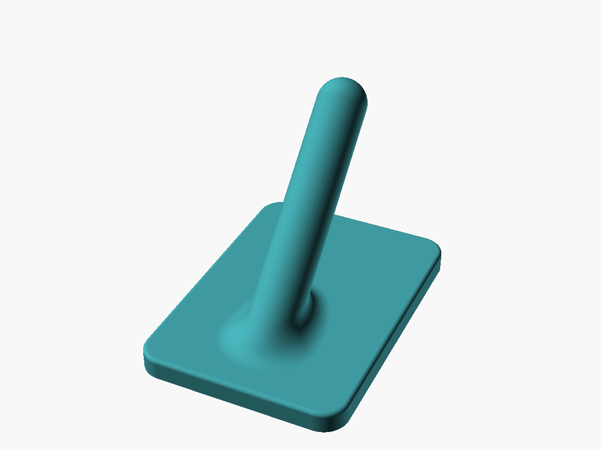
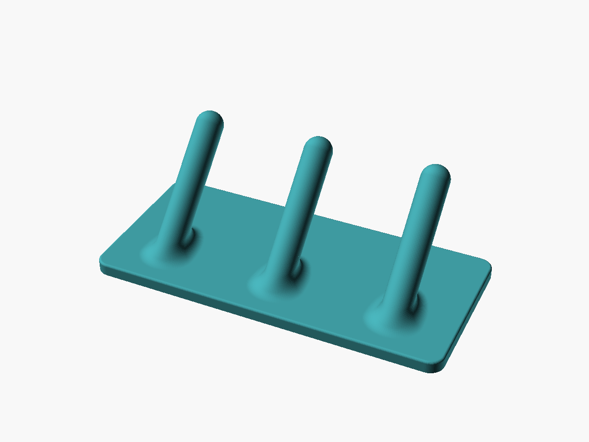

# Vešiak na uteráky

Malý vešiak, ktorý sa **lepí na stenu obojstrannou páskou**. Z dosky vychádza šikmý kolík (45° od steny) s guľovým koncom, uterák z neho nezošmykne. Pôvodne navrhnutý vo Fusion 360, tu prerobený na parametrický OpenSCAD: dá sa meniť veľkosť dosky, **počet kolíkov na jednej doske**, priemer, dĺžka a uhol kolíka.

## Súbory
| Súbor | Čo to je |
|---|---|
| `scad/vesiak.scad` | parametrický model |
| `scad/vesiak.json` | sady z Customizera: `original_fusion`, `3_koliky`, `velky_1` |
| `stl/vesiak_1.stl` | predvolený vešiak (1 kolík, kolík v strede dosky) |
| `stl/vesiak_original_fusion.stl` | sada `original_fusion` – rozmerovo zhodná s pôvodným modelom |
| `stl/vesiak_3_koliky.stl` | 3 kolíky na jednej doske 75 × 35 mm |
| `stl/vesiak_velky_1.stl` | väčší vešiak: doska 30 × 50, kolík Ø 8 × 45 mm, 50° |
| `stl/original_fusion360.stl` | pôvodný export z Fusion 360 (referencia, z neho sa merali rozmery) |
| `nahlady/` | náhľady z OpenSCAD (spredu, 3 kolíky, zozadu s kapsou na pásku) |

## Hlavné rozmery a parametre
| Parameter | Predvolené | Význam |
|---|---|---|
| `pocet_kolikov` | 1 | počet kolíkov vedľa seba na jednej doske |
| `roztec` | 25 mm | rozostup kolíkov = šírka dosky na jeden kolík (šírka dosky = počet × rozteč) |
| `vyska_dosky` | 35 mm | výška dosky na stene |
| `hrubka_dosky` | 3,0 mm | zaokrúhli sa na násobok vrstvy (15 vrstiev) |
| `priemer_kolika` | 6 mm | |
| `dlzka_kolika` | 31,6 mm | pozdĺž osi, od povrchu dosky po špičku gule |
| `uhol_kolika` | 45° | od steny; 90 = kolmo. Min. 45°, pri PETG 50° – menší uhol sa automaticky zdvihne (ECHO vypíše POZOR) |
| `r_zaoblenia` | 3 mm | zaoblenie pri koreni kolíka |
| `posun_kolika` | 0 mm | posun kolíka hore/dole; 0 = pôdorys kolíka v strede dosky |
| `kapsa` | áno | kapsa na pásku na zadnej strane, 1 mm hlboká, okraj 2 mm |

Odvodené hodnoty (ECHO, predvolené): doska 25 × 35 × 3 mm, **vyloženie zo steny 26,2 mm**, koreň kolíka 8,6 mm od spodnej hrany, kapsa 21 × 31 × 1 mm.

Kontroly (`assert`): kolík ani špička nepresahujú dosku, rozteč je väčšia ako kolík so zaoblením, nad kapsou ostanú aspoň 4 vrstvy, diel sa zmestí na podložku.

## Ako vznikol z originálu
Rozmery som zmeral z pôvodného STL (rezy v rôznych výškach, vrcholy siete):
- doska 25 × 35 × 3 mm, rohy R 3, horná hrana zaoblená R 0,5,
- kolík Ø 6 mm pod 45°, guľa na konci, zaoblenie pri koreni R 3,
- na zadnej strane kapsa na pásku 21 × 31 × 1 mm s rohmi R 2.

Sada `original_fusion` dáva v rezoch rovnaké rozmery ako originál (rozdiel do 0,03 mm, pri samotnej doske 0,2 mm). Objem 2,90 vs. 2,90 cm³ – jediný rozdiel je **skosenie spodnej hrany 0,4 mm** proti elephant foot, ktoré originál nemal.

## Konštrukčné rozhodnutia
- **Zaoblenie pri koreni** je rovnaké ako vo Fusione (rolling ball): pod kolíkom (ostrý kút 45°) je široké ~7 mm, nad ním (tupý kút) len ~1 mm. Spevňuje koreň, kde je najväčší ohybový moment, a pod kolíkom má sklon ≤ 45°, takže sa tlačí bez podpier.
- **Guľa na konci** pri sklone 45° nemá žiadnu plochu s previsom nad 45° (overené v STL).
- **Kolík v strede dosky** – predvolene je pôdorys kolíka (od zaoblenia po priemet špičky) vycentrovaný na výšku dosky. Originál ho mal o 1,9 mm vyššie, to dáva sada `original_fusion` (`posun_kolika = 1.87`).
- **Viac kolíkov = viac kapsí.** Každý kolík má vlastnú kapsu na pásku a medzi nimi je 4 mm rebro. Jedna dlhá kapsa by mala strop – most – cez celú výšku dosky (31 mm), takto ostáva most 21 mm.
- **Kapsa na pásku – zvážiť:**
  - Plus: okraj zakryje pásku z boku, vešiak sedí na stene čisto.
  - Mínus: strop kapsy je **most 21 mm** (pravidlo pre 0,4 trysku je ~15 mm). H2C ho vytlačí, ale spodok mostu je mierne zvlnený a **páska sa lepí práve naň**. Páska musí byť **hrubšia ako 1 mm** (napr. penová 1,1–1,6 mm), inak na stenu dosadne okraj a nie páska.
  - Alternatíva `kapsa = false`: páska sa lepí na rovný spodok dosky z podložky – najlepšia priľnavosť, žiadny most, ale páska je zboku vidno.
- **Pevnosť kolíka:** pri tlači doskou dole idú vrstvy cez kolík šikmo (45°). Na uterák to stačí; ak by kolík praskal pri koreni, zväčši `r_zaoblenia` alebo `priemer_kolika` skôr ako výplň – kolík Ø 6 pri wall loops 4 je aj tak celý z perimetrov.
- **Spotreba:** ~2,9 cm³ ≈ 3,6 g PLA na 1 kolík, 3 kolíky ~9 cm³ ≈ 11 g. Čas zo slicera zatiaľ nemám.

## Nastavenie slicera
0,4 tryska · 0,20 vrstva · **wall loops 4** · top/bottom 5/4 · výplň 15 % gyroid · PLA · hladká PEI doska (rovný zadný povrch) · podpery nie · doskou na podložku.

PETG (vlhká kúpeľňa) ide tiež. Pri prepnutí `material = "PETG"` sa kolík sám zdvihne na 50° od steny (previs max. 40°), vyloženie zo steny narastie z 26,2 na 27,9 mm.

## Výsledky tlače
| Dátum | Sada | Materiál | Čas / g | Výsledok |
|---|---|---|---|---|
| – | – | – | – | zatiaľ netlačené z OpenSCAD verzie |

## Ako pokračovať
- Render (z priečinka projektu): `openscad --backend=manifold -o stl/vesiak_3_koliky.stl -p scad/vesiak.json -P 3_koliky scad/vesiak.scad`
- Vlastné rozmery: `openscad --backend=manifold -o stl/vesiak.stl -D pocet_kolikov=4 -D roztec=30 -D dlzka_kolika=40 scad/vesiak.scad`
- Náhľad: `openscad --render -o nahlady/vesiak.png --imgsize=1200,900 --viewall --autocenter --colorscheme=Tomorrow --camera=0,0,0,55,0,25,0 scad/vesiak.scad`
- Po prvej tlači doplniť čas, gramy a ako drží páska (kapsa vs. bez kapsy).
