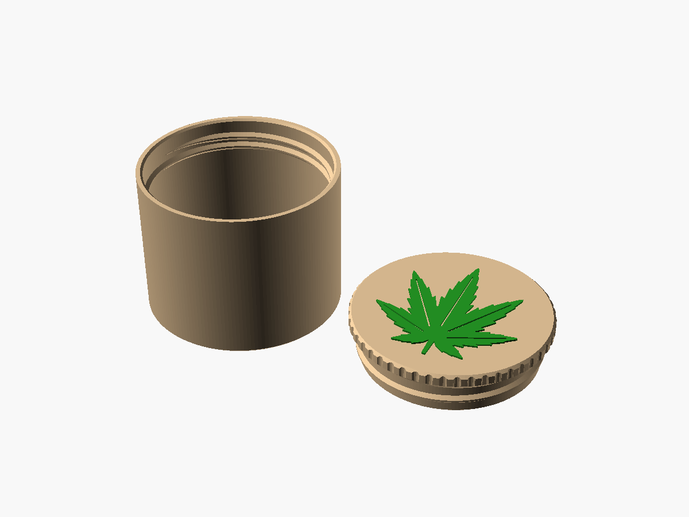
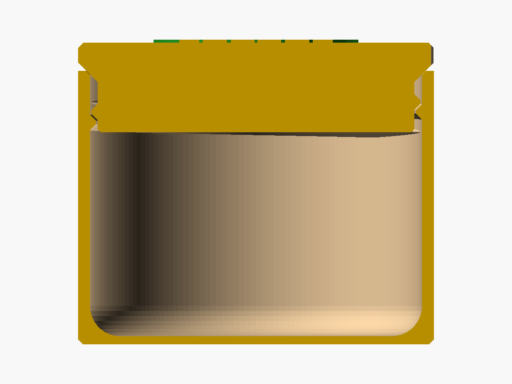

# Weed box – okrúhla krabička so závitom

Skrutkovacia krabička z dvoch dielov: **telo** s vnútorným závitom a **viečko** s vonkajším závitom, na ktorom je navrchu embosovaný lístok cannabis sativa (7 pílovitých lístkov). Zatvorená je hladký valec, viečko má rovnaký priemer ako telo a je oddelené len úzkou drážkou. Oba diely sa tlačia bez podpier.

| Rez zatvorenej krabičky | Lístok zhora |
|---|---|
|  |  |

## Hlavné rozmery a parametre
| Parameter | Predvolené | Význam |
|---|---|---|
| `priemer` | 70 mm | vonkajší priemer tela aj viečka |
| `vyska` | 60 mm | celková výška zatvorenej krabičky vrátane lístka |
| `stupanie` | 4 mm | stúpanie závitu |
| `hlbka_zavitu` | 1,2 mm | radiálna výška rebra |
| `otacky` | 1,5 | dĺžka závitu = koľko sa viečko skrutkuje |
| `vola_zavitu` | 0 = auto | vôľa radiálne aj na boku rebra, auto podľa trysky a materiálu |
| `velkost_listka` | 52 mm | od konca stopky po špičku |
| `vyska_listka` | 0,6 mm | výška embosu, zaokrúhli sa na násobok vrstvy |
| `zilky` | áno | stredná žilka vyrezaná vo väčších lístkoch |
| `ryhy` | áno | zvislé ryhy na okraji viečka na úchop |
| `diel` | `oba` | `telo`, `vicko`, `oba`, `zostava`, `rez`, `prienik` (kontrola) |
| `tryska` / `vrstva` / `wall_loops` | 0,4 / 0,20 / 3 | z nich sa počíta hrúbka steny |

Odvodené hodnoty (ECHO, predvolená sada):
- stena **2,31 mm (6 liniek)**, dno 1,6 mm (8 vrstiev), rovná hrana tela 1,55 mm (4 linky),
- telo vysoké 53,83 mm, vnútri Ø 65,39 mm, otvor cez rebro Ø 62,99 mm,
- viečko 17,6 mm + lístok 0,6 mm (3 vrstvy), zátka Ø 62,39 × 9,88 mm,
- závit: boky 45°, vôľa 0,30 mm (axiálne 0,42 mm na bok), vrchol rebra 0,68 mm, päta 3,08 mm, záber 0,9 mm,
- **užitočný objem ~135 ml** (Ø 65,4 × 40,2 mm pod zátkou).

Sady v `scad/weed_box.json`: `predvolena_70x60`, `mala_50x45` (~41 ml), `velka_90x80` (~345 ml), `petg_70x60`, `tryska06_70x60`.

### Ladenie závitu
- Viečko ide ťažko alebo drhne → `vola_zavitu` 0,35–0,40.
- Viečko má veľkú vôľu → `vola_zavitu` 0,25. Pri zmene najprv vytlač len viečko, je to kratšia tlač než telo.
- Pri PETG sa vôľa zvýši o 0,05 mm a boky rebra aj sedlo sa zmenia na 40°, viečko je tým o 1 mm vyššie.

## Konštrukčné rozhodnutia
- **Vonkajší závit je na viečku (viečko je zátka), nie na tele.** Toto je hlavné rozhodnutie. Klasické viečko s plášťom okolo hrdla by sa pri tlači lístkom hore muselo klenúť zvnútra cez ~65 mm, čo je ďaleko nad limit mosta (15 mm). Porovnané varianty:

  | Variant | Lístok | Podpery | Nevýhoda |
  |---|---|---|---|
  | **Zátka, lístok hore (zvolené)** | vystúpený, čistý | nie | zátka zaberá ~10 mm vnútornej výšky, viečko je plné s výplňou |
  | Plášťové viečko, lístok dole na doske | vystúpený lístok by visel vo vzduchu | áno | emboss sa takto vytlačiť nedá, ostal by len vtlačený lístok |
  | Plášťové viečko, lístok hore, vnútorný kužeľ 45° | vystúpený | nie | viečko vysoké ~35 mm a veľký klin výplne, viac materiálu aj času |
  | Viečko z dvoch dielov (krúžok + kotúč) | vystúpený | nie | tretí diel a lepený spoj |

- **Lichobežníkový závit s bokmi 45°.** Spodný bok rebra je najväčší previs na diele a vyjde presne na limit bez podpier. Hlboké 1,2 mm rebro so stúpaním 4 mm dáva vrchol 0,68 mm, teda ~3 vrstvy, takže sa rebro nedrobí. Konce rebra plynule nabiehajú zo steny počas 45°, závit sa ľahko chytí.
- **Vôľa 0,30 mm** je medzi posuvným a voľným spojom z tabuľky tolerancií pre trysku 0,4. Rovnaká hodnota platí radiálne aj kolmo na bok rebra. Pri 0,6 tryske je to 0,40 mm, pri 0,8 tryske 0,50 mm (0,8 v tabuľke nie je, hodnota je odhad).
- **Kužeľové sedlo 45° namiesto rovnej dosadacej plochy.** Spodok okraja viečka musí byť šikmý, aby sa tlačil bez podpier, preto je rovnako šikmé aj ústie tela. Slúži ako doraz aj ako nábeh pri nasadzovaní. Od hornej hrany tela ostáva drážka hlboká 1,55 mm, ktorá zároveň opticky oddeľuje diely.
- **Stena 6 liniek (wall loops 3)** namiesto 4 liniek, aby sa telo pri skrutkovaní neovalilo a ústie sedla ostalo pevné. Stojí to ~10 g navyše.
- **Zaoblenie R 6 pri dne** – obsah sa dá ľahko vybrať, tlačí sa to bez previsu.
- **Lístok** je vlastný 2D obrys v OpenSCAD, nie import. Prvky tenšie ako ~1 linka sa odstránia (`offset`), aby slicer nevytváral prázdne miesta. Max. polomer lístka je 26,3 mm, od okraja ostáva ~8 mm.
- **Dvojfarebná verzia je lacná.** Lístok začína na z = 17,6 mm, výmena filamentu je jedna, len na posledné 3 vrstvy (v Bambu Studiu zmena filamentu v danej vrstve).
- **Zvolené predvolene, lebo to v zadaní chýbalo:** priemer 70 mm, výška 60 mm, PLA, tryska 0,4 (závit a lístok potrebujú detail), 1,5 otáčky.
- Krabička nie je vzduchotesná, závit z FDM netesní. Ak má držať vôňu, treba dať pod viečko tesnenie.

## Kontrola návrhu
Vykonané pre všetkých 5 sád v JSON:
- render bez chýb, `assert` prešli, STL uzavreté (manifold), 1 teleso na diel,
- **previsy z normál STL:** max. 45,00° (PETG 40,00°), žiadna plocha nad limitom okrem plochy na doske,
- **sedenie závitu (`diel="prienik"`):** prienik tela a viečka je nulový v zatvorenej polohe aj pri odskrutkovaní o 15–900° (14 polôh).
- **Axiálne overenie (predvolená sada):** viečko sa dotkne sedla po posune −0,10 mm a boku rebra po +0,42 mm, presne podľa výpočtu. Pri ťahu hore teda rebrá viečko držia.

Kód je napísaný pre OpenSCAD 2021.01 aj 2024+, skúšaný bol vo verzii 2026.10 (Manifold).

## Nastavenie slicera
0,4 tryska · 0,20 vrstva · **wall loops 3** · top/bottom 5/8 · výplň 15 % gyroid (nesie vrch viečka) · **PLA (AMS 2 Pro)** · Textured PEI · podpery nie · telo dnom dole, viečko lístkom hore (ako v STL).

## Súbory
| Súbor | Čo to je |
|---|---|
| `scad/weed_box.scad` | hlavný model, oba diely |
| `scad/weed_box.json` | sady parametrov z Customizera |
| `stl/weed_box_telo.stl` | telo, predvolená sada |
| `stl/weed_box_vicko.stl` | viečko, predvolená sada |
| `nahlady/weed_box.png` | telo a viečko vedľa seba |
| `nahlady/weed_box_rez.png` | rez zatvorenej krabičky |
| `nahlady/weed_box_listok.png` | viečko zhora |

Priečinky `3mf/` a `vyroba/` pribudnú po prvej tlači.

## Výsledky tlače
Zatiaľ netlačené. Odhad z objemu STL (nie zo slicera): telo ~42 g, viečko ~22 g pri 15 % výplni, spolu ~65 g PLA.
